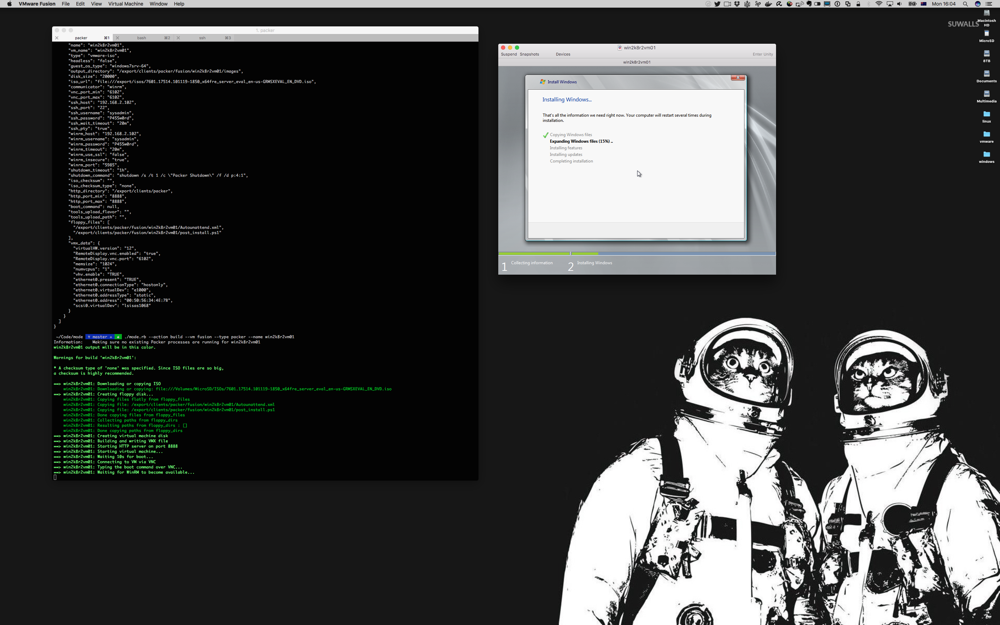

MODEST
======

Version: 10.3.9

License
-------

CC BY-NC-SA: https://creativecommons.org/licenses/by-nc-sa/4.0/

Fund me here: https://ko-fi.com/richardatlateralblast

Introduction
------------

MODEST stands for: Multi OS Deployment Engine Server Tool

WARNING: This is a somewhat significant clean up of the previous tool (mode) - it is currently not working for everything

Known to be working:
- Packer (Windows, CentOS, RHEL, Ubuntu, ESXi, SLES 12.x, Solaris 11 x86)
- PXE Server (vSphere/ESXi, Ubuntu, etc)
- VMware Fusion/Workstation and VirtualBox VM creation
- Solaris 11 AI
- Solaris 10 Jumpstart

Issues:
- Packer Windows installs do not work for host-only network configs (Packer issue)
  - set vmnetwork to NAT

This tool is designed to greatly simplify the creation of VMs for testing purposes.

With a single command line command you can create and manage VMware Fusion and VirtualBox VMs.

MODEST is a Ruby script to configure server and client configuration for Packer, PXE/DHCP, BOOTP
and HTTP based install services, eg:

- Solaris 11 Automated Installer (AI) service
- Solaris 10 (and earlier) Jumpstart services
- Centos, Scientific, OEL, Fedora, and RHEL Kickstart services
- Ubuntu Linux Preseed and Subiquity services
- SuSE Enterprise Linux AutoYast services
- ESXi Kickstart services
- PXE boot install services for Linux and ESXi
- Simplify creation, deletion, snapshot, import and export of VirtualBox VMs
- Simplify creation, deletion, snapshot, import and export of Parallels VMs
- Simplify creation, deletion, snapshot, import and export of VMware Fusion VMs
- Simpllfy creation of Solaris Zones
- Simplify creation of Solaris VM Server for SPARC Control Domains
- Simplify creation of Solaris VM Server for SPARC Guest Domains
- Linux Containers (Currently Ubuntu support only)
- OpenBSD PXE boot service
- Initial CoreOS PXE boot support
- Provide completely headless VM support
- Simplify creation of Packer images
- Deploy Virtual Center Server Appliance
- Simplify creation and build of VMs with Packer
  - Linux (RHEL, OEL, SuSE, Ubuntu, CentOS, Fedora, Scientific)
  - Solaris 10 & 11
  - Windows Server 2008 R2, 2012 R2, 2016, 2019, 2022
  - ESXi
  - Create AMIs
- AWS support
  - List, stop, start, create, and delete instances
  - List and delete AMIs
  - List, create and delete buckets
  - List bucket ACLs
  - Upload and download files to/from buckets
  - List, create, and delete CloudFormation stacks
  - List, create and delete EC2 security groups and rules
- Initial Docker support
- Initial Ansible support
  - Create AWS EC2 instances

Currently supported host Operating Systems:

- Linux
- Mac OS
- Solaris
- Windows (in development)

Currently supported virtualisation software:

- VirtualBox
- VMware Workstation / Fusion
- KVM (Requires Packer 1.4.3 or later)
- Docker (in development)
- Multipass

Less supported (have not been recently tested)
- Parallels
- Zones
- Solaris OVM

Currently supported deployment software:

- Packer (1.4.3 or later recommended - required for KVM support)

Currently supported deployment targets with packer:

- VirtualBox
- VMware Fusion
- AWS

Screenshots
-----------

Some example screen captures:

[vSphere/ESXi Client Example](https://github.com/lateralblast/modest/wiki/vSphere-Client-Screen-Capture)

[Windows Client Example](https://github.com/lateralblast/modest/wiki/Windows-Client-Screen-Capture)

[RedHat Linux Kickstart Client Examples](https://github.com/lateralblast/modest/wiki/Kickstart-Client-Screen-Capture)

[Ubuntu Linux Preseed Client Examples](https://github.com/lateralblast/modest/wiki/Preseed-Client-Screen-Capture)

[Solaris 11 Client Examples](https://github.com/lateralblast/modest/wiki/AI-Client-Screen-Capture)

Background
----------

Why another OS/VM deployment tool?

Most of the other tools Packer, Vagrant, etc, concentrated on NAT based configurations.
If they did have host-only network support, it didn't always work correctly (e.g. Packer and VirtualBox).
Also I wanted a tool which I could use to build configurations for physical or virtual machines.

In most cases I was using PXE to boot and install physical machines, or virtual machines.
I was also using a number of different OSes, e.g. Solaris, Windows, Linux, etc.
I was also having issues with earlier versions of Packer and deploying Solaris and vSphere,
where the install would stall part way through. This has since been fixed, and I've added Packer support.

The script will try to install the required modules, therefore I would recommend like with any other
Ruby development environment you run your own version under rbenv or similar.

The script will make system changes, therefore I recommend you run in on a development machine, or in a VM.

License
-------

This software is licensed as CC BY-NC-SA (Creative Commons Attribution-NonCommercial-ShareAlike)

http://creativecommons.org/licenses/by-nc-sa/4.0/legalcode

Usage
-----

Mode is designed to be used in a number of scenarios:

- Testing vendor OS deployment technologies (e.g. Kickstart, Jumpstart etc)
  - PXE boot
  - Pre and post install scripts
- A environment for quickly deploying VMs for testing purposes
  - In a similar fashion to veewee or vagrant
- An environment for quickly deploying servers in a Datacenter or testlab via cross-over cable

Headless VMs and the serial console
-----------------------------------

On Apple Silicon, a VMware Fusion VM created for a cloud-init (Ubuntu live server) install can be booted headless, with the terminal connected to its serial console:

    ./modest.rb --action boot --vm fusion --name <vm> --headless

To reconnect to a running VM's console later, without typing socat:

    ./modest.rb --action connect --vm fusion --name <vm>

The console shows the boot and install output, and typed input goes to the VM. Ctrl-] disconnects and leaves the VM running. Creating a VM does not boot it. The console socket is `<export>/state/consoles/<vm>.sock`, so it can also be reached with `socat - UNIX-CONNECT:<socket>`. See the wiki page Headless Console for examples.

Checking and installing tools
-----------------------------

    ./modest.rb --action check --check packer
    ./modest.rb --action check --check packer --install

`--action check` with no `--check` prints the available checks and exits. `--check` takes one of `perms`, `dnsmasq`, `dhcp`, `tftp`, `virtualbox`, `fusion`, `workstation`, `parallels`, `packer` or `kvm` (`kvm` checks that KVM is installed and that the user is in the `kvm`, `libvirt`, `libvirt-qemu` and `libvirt-dnsmasq` groups. Missing groups are added with `usermod`, and the user must log out and back in for them to apply. With `--install`, a missing KVM is installed). `docker` checks that the `docker` and `docker compose` (or `docker-compose`) commands are installed, that the daemon is reachable, and that the user is in the `docker` group (Linux; missing membership is added and needs a re-login). With `--install`, missing tools are installed. `--check perms` checks client directory permissions. `--check packer` reports the Packer version and path, or that Packer is missing. With `--install`, a missing Packer is installed with Homebrew from the HashiCorp tap (`brew install hashicorp/tap/packer`) on macOS. On other systems it prints the download page instead.

Deployment server VM
--------------------

    ./modest.rb --action create --vm deployment-server --sshkeyfile ~/.ssh/id_ed25519.pub
    ./modest.rb --action delete --vm deployment-server

`--vm deployment-server` builds a KVM VM from the Ubuntu 26.04.1 LTS cloud image. The image is
downloaded into `/var/lib/libvirt/images` on first use and checked against its SHA256. Each VM gets
a qcow2 overlay on that shared base image, with 2 vCPUs, 4096 MB of memory and a 40G disk. The
cloud-init seed renames the default cloud user to the current user (keeping UID 1000), adds the
public key from `--sshkeyfile`, turns off password SSH, and installs `etckeeper` and `nfs-common`.

Create also writes a marked NFS export block to `/etc/exports` for `/export/isos`, `/export/pkgs`
and `/export/repo` (read-only) and `/export/clients` and `/export/images` (read-write), to the
libvirt default network `192.168.122.0/24`. The original file is saved as `/etc/exports.before-modest`
the first time. A VM that already exists is not changed.

The VM has the fixed address `192.168.122.10` on the libvirt default network. Create moves that
network's DHCP pool to `192.168.122.100`-`192.168.122.254`, so the fixed address is outside it, and
adds a marked `deployment-server` line to `/etc/hosts` (the original is saved as
`/etc/hosts.before-modest`). Connect with `ssh <user>@deployment-server`. The first connection needs
the host key accepted (for example `StrictHostKeyChecking=accept-new`).

Delete stops and undefines the VM, removes only its own overlay and seed, and removes its `/etc/hosts`
line. The base image, the NFS exports and the DHCP pool are shared and are kept.

Listing networks
----------------

    ./modest.rb --action list --type network [--vm fusion|vbox|qemu|libvirt|parallels|multipass]

Lists the host networks VMs can use: VMware Fusion (vmnet), VirtualBox (host-only and NAT), QEMU user-mode networking, libvirt (KVM) networks, Parallels networks (from `prlsrvctl`) and Multipass (the host interfaces it can bridge to, from `multipass networks`, with the driver and bridged network setting). Each hypervisor is listed only when it is installed, and `--vm` limits the listing to one of them.

Features
--------

Linux

- Where possible I've used biosdevnames as part of installation to reduce network device renaming

Packer support

- Simplify creation of Packer images for VirtualBox and VMware Fusion
- Currently supports Solaris 10, Solaris 11,
  Linux (RHEL, OEL, SuSE, Ubuntu, CentOS, Fedorac, Scientific),
  Windows Server 2008 R2, 2012 R2, 2016, 2019, 2023, ESXi

Linux Container Creation

- Installs required packages and sets up network for public facing containers
  that can be connected to via ssh (Currently Ubuntu support only)
- Creates containers and sets up network (Currently Ubuntu support only)

Oracle VM Server for SPARC

- Setup Control Domain based on a set of questions
- Cleate Guest Domains based on a set of questions

VirtualBox and VMware Fusion VM creation

- Can create VMs to speed up the automation of testing new images
- Can run VMs headless and connect via serial allowing remote installation

Parallels VM creation

- Can create and delete VMs
- Can boot/stop VMs

Solaris Zone Creation

- Asks a set of questions to generate a template and then install a zone

Solaris 11 AI

- If a local repository exists it is used to configure installation services
- If a local repository is not present it mounts the repository ISO and
  configures it
- Changes the default install service manifest to reboot servers after
  installation
- Changes the default install service to use the local repository rather than
  the default Oracle one
- Changes the default grub configuration default to an autamated install rather
  than an interactive one
- Disables the default range based DHCP configuration and adds clients on an
  individual basis
  - Reduces the chances of conflicts with existing DHCP services, and
  - Resolves the issue of DHCP licenses running out
- Creates an individual configuration profile for each client
  - Configures network and other services
- Includes code to optionally create alternate package repository
  - Automatically builds packages for facter, hiera, and puppet
  - Adds packages to base installation manifest
- Post installation script capability (work in progress)

CentOS, Scientific Linux, Fedora, and RedHat Linux Kickstart

- Creates an Apache directory and alias for a HTTP based installation
- Creates PXE configuration that jumps straight into an installation and pulls
  kickstart file from server
- Includes code for optionally installing additional packages
  - Automatically downloads Puppet packages
  - Add packages to post installation

Ubuntu Linux Preseed

- Adds required append statement to PXE configuration so install is fully
  automated
- Currently only basic client support (auto partitions disk)

OpenSuSE Linux and SLES (SuSE Enterprise Linux) AutoYast

- Creates AutoYast XML file based on answers to questions

Solaris 10 (and earlier) Jumpstart:

- Automatically tries to determine boot and mirror disk ids based on modestl
- Automatically tires to determine kernel architecture (e.g. sun4u / sun4v)
  based on modestl
- Ability to quickly deploy flar based installs by answering a few questions

ESXi Kickstart:

- Automatically created PXE boot and jumpstart configuration files
- Automatically adds post install commands to turn on ESXi services such as SSH

All:

- Asks a set of default questions to produce a consistent error checked profile
  for each client
- Makes sure clients are added and deleted correctly removing the chance of
  installing the wrong thing to the wrong machine
- Installs and configures (and uninstalls and unconfigures if needed) server
  services (DHCP etc)
- Post installation scripting to perform tasks such as patching and security

Architecture
------------

The architecture of modestst is made up of the following layers:

- Host machine
  - Can be a laptop or a server
  - Manages VMs (including Deployment Server)
  - Provides hostonly or bridged networking for VMs
  - Can provide boot services for external machines via cross-over cable or switch
  - Can be used to provide installation media (ISOs) to deployment server via shared filesystem
- Deployment Server
  - Manages OS installation media (ISOs) and repositories
  - Manages PXE boot configurations
    - The VMs on the host you wish an OS to be installed to
    - External machines you may wish to install and OS to (e.g. Testlab or DC)
  - Manages client VM configurations
    - The VMs on the host you wish an OS to be installed to
    - External machines you may wish to install and OS to (e.g. Testlab or DC)
  - Manages post installation scripts

I'll go into more detail and an actual example of the process in the getting
started section, but basically the process of deploying a VM is as follows:

- Create a blank VM on the host machine
- Configure the VM installation template/configuration on the Deployment Server
- Boot the VM on the host machine and let it PXE boot and install

By default the script uses a hostonly network, 130.194.2.0 for VMware Fusion, and
130.194.56.0 for VirtualBox. As such the script will try to configure port forwarding.

Hostonly networks and IP forwarding is used as it's far more reliable for consistent deployments.

An example host-only network layout For VMware Fusion with vmnet interfaces is as follows:

```
__ External network __ External Interface (e.g. en0)
   e.g. 192.168.1.0    e.g. 192.168.1.100
                               |
                               |
                            VM Host
                               |
                               |
                        Host-only Interface (e.g. vmnet1) __  Host-only network
                        e.g. 192.168.52.1                     e.g. 192.168.52.0
                                                                    |
                                                                    |
                                ____________________________________|
                                |
            ____________________|____________________
            |                   |                   |
            |                   |                   |
  Deployment Server        Test Server 1
  e.g. 192.168.52.100     e.g 192.168.52.101
```

An example host-only network layout For VMware Fusion with bridge interfaces (MacOS BigSur) is as follows:

```
__ External network __ External Interface (e.g. en0)
   e.g. 192.168.1.0    e.g. 192.168.1.100
                               |
                               |
                            VM Host
                               |
                               |
                    Host-only Interface (e.g. bridge100) __  Host-only network
                    e.g. 192.168.104.1                        e.g. 192.168.104.0
                                                                    |
                                                                    |
                                ____________________________________|
                                |
            ____________________|____________________
            |                   |                   |
            |                   |                   |
  Deployment Server        Test Server 1
  e.g. 192.168.104.100     e.g 192.168.104.101
```

An example host-only network for VirtualBox is as follows:

```
__ External network __ External Interface (e.g. en0)
   e.g. 192.168.1.0    e.g. 192.168.1.100
                               |
                               |
                            VM Host
                               |
                               |
                        Host-only Interface (e.g. vboxnet0) __ Host-only network
                        e.g. 192.168.56.1                      e.g. 192.168.56.0
                                                                     |
                                                                     |
                                _____________________________________|
                                |
            ____________________|____________________
            |                   |                   |
            |                   |                   |
  Deployment Server        Test Server 1
  e.g. 192.168.56.100      e.g 192.168.56.101
```

An example of host-only network for KVM is as follows:

```
__ External network __ External Interface (e.g. en0)
   e.g. 192.168.1.0    e.g. 192.168.1.100
                               |
                               |
                            VM Host
                               |
                               |
                        Host-only Interface (e.g. virbr0) __ Host-only network
                        e.g. 192.168.122.1                   e.g. 192.168.122.0
                                                                   |
                                                                   |
                                ___________________________________|
                                |
            ____________________|____________________
            |                   |                   |
            |                   |                   |
  Deployment Server        Test Server 1
  e.g. 192.168.122.100     e.g 192.168.122.101
```

Requirements
------------

As this script is written in ruby, and requires ruby modules,
I recommend installing non system ruby with a package such as rbenv.

https://github.com/rbenv/rbenv

An example of that process on Ubuntu:

```
sudo apt-get update
sudo apt-get -y install rbenv
echo 'eval "$(rbenv init -)"' >> ~/.bashrc
exec $SHELL
rbenv install 3.1.2
rbenv global 3.1.2
```

All:

- Socat
- Ruby
  - Version 1.8 or greater
    - Although it's been coded with 2.x I've avoided using 2.x features
- Packer (if using Packer)
- Ansible (if using ansible)
  - boto python module
- Docker (if using Docker)
  - docker
  - docker-machine
  - docker-compose
- Required Gems
  - rubygems
  - getopt/long
  - builder
  - socket
  - parseconfig
  - unix_crypt
  - pathname
  - netaddr
  - ipaddr
  - json
  - yaml
  - pp
  - aws-sdk
  - ssh-config
  - open-uri
  - net/ssh
  - nokogiri
  - mechanize
  - uri
  - socket
  - net/http
  - net/scp


Required Packages for Linux:

- git
- gcc
- ruby-devel
- xz-devel
- zlib-devel
- libxml2-devel
- libgpg-error-devel
- libgcrypt-devel
- libxslt-devel
- libstdc++-devel
- gcc-c++
- libgnome-keyring
- perl-Error
- perl-TermReadKey
- git
- Perl-git
- libapr
- libapr-util
- mail-cap
- httpd-tools
- httpd
- xinetd
- tftp-server
- dhcp
- winlib (for building Windows VMs with Packer)
- net-tools (required for ifconfig on Ubuntu)


Required packages for Mac OS:

- winlib (for building Windows VMs with Packer)

Required packages for Windows:

- cygwin
  - ruby
  - git
  - curl

Kickstart, AutoYast, and Preseed Services:

- Solaris 11, Linux, or OS X

AI Services:

- Solaris 11

Jumpstart Services:

- Solaris 11 or OS X (Linux to be added)

Linux Containers:

- Linux (Currently only Ubuntu supported)

Solaris Containers:

- Solaris 10 or 11 (Some branded container support on Solaris 11)

VM Client Services:

- VMware Fusion or VirtualBox

Prior to VirtualBox 5.x, bridged networking on OS X has been severely broken,
therefore it is recommended to use VirtualBox 5.x or VMware Fusion if available.

If using OS X and a installation platform for Jumpstart it is recommended to
use flar based installs as the performance of the OS X NFS is poor

- Parallels

There is initial Parallels support for creating VMs

Possible Future Additions
-------------------------

Some of the things I'd like to add support for:

- Vagrant and Veewee
- VMware API
- OpenStack
